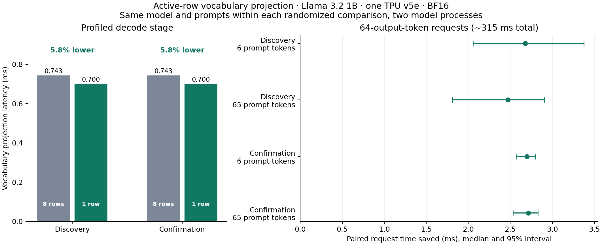

# From padding measurements to an active-row vocabulary optimization

The prompt-length study identified a vocabulary projection that takes about
0.74 ms and receives eight padded rows for one active request. We implemented
a small JAX adapter that projects only the active hidden-state row, then pads
the logits back to the shape expected by the serving sampler.

On pretrained BF16 Llama 3.2 1B on one TPU v5e, this reduces vocabulary-stage
latency by **5.8%**, device forward latency by about **1.2%**, and the median
latency of 64-output-token requests by about **0.9%** in a second-process
confirmation. These percentages describe different measurement scopes.

## Confirmed results

| Profiled decode measurement | Baseline | Active row | Latency reduction |
| --- | ---: | ---: | ---: |
| Vocabulary projection | 0.74332 ms | 0.70010 ms | 5.81% |
| Full device forward window | 3.36709 ms | 3.32542 ms | 1.24% |
| Backbone | 2.61578 ms | 2.61584 ms | Essentially unchanged |

The component table uses medians over the observed decode steps in the
confirmation profiles. Five profiling rounds each contain two generation
requests per policy, with seven decode steps per request: 70 decode observations
per policy. These steps are not 70 independent experiments.

| Unprofiled 64-output-token request | Baseline median | Active-row median | Latency reduction |
| --- | ---: | ---: | ---: |
| Six-token prompt | 315.608 ms | 312.722 ms | 0.91% |
| 65-token prompt | 316.407 ms | 313.579 ms | 0.89% |

Each request condition has 24 observations per policy in randomized complete
rounds. Median paired time saved is **2.696 ms** for the short prompt and
**2.713 ms** for the longer prompt. Paired bootstrap 95% intervals are
**[2.569, 2.799] ms** and **[2.533, 2.830] ms**, respectively. Ratios of condition
medians and medians of paired differences are different statistics.

The discovery run showed the same 5.8% vocabulary-stage reduction and
0.58–1.07% request-latency reductions. Confirmation used a second model process,
a different performance prompt corpus for the longer prompt, a different
randomization seed, and twice as many request timing rounds. Both processes
ran on the same TPU VM, so this is not a second-machine replication.



## The change

The upstream JAX Llama vocabulary projection is a matrix product over selected
hidden-state rows. Its rows are independent. For this one-request configuration,
row zero is active and the remaining seven rows exist for serving padding.

The measured adapter is equivalent to:

```python
@jax.jit
def active_compute_logits(state, hidden, lora):
    logits = original_logits(state, hidden[:1], lora)
    return jnp.pad(logits, ((0, hidden.shape[0] - 1), (0, 0)))
```

This compiles the row selection, projection, and restoration of the padded
output shape together. The sampler keeps its expected eight-row input shape.
The benchmark guards the adapter to one active request, one device, the pinned
native JAX Llama implementation, and operation without speculative decoding or
prompt log probabilities. The executed source is included with both runs.

The measured saving is about 43 microseconds per decode step. Across 64
generated tokens, that predicts roughly 2.7 ms, consistent with the paired
request-level measurements. The measured device backbone remains essentially
unchanged.

## Correctness gates and rejected candidates

Before timing, each candidate is checked on 12 prompt cases: four lengths across
three text corpora. We compare the full 128,256-element first-step vocabulary
vector against the baseline with `rtol=0.02`, `atol=0.0625`, require finite
values, and require exactly matching 16-token greedy continuations. The active
row adapter passes every case in both processes, with maximum absolute logit
difference **0.03125**. BF16 results are numerically close rather than bitwise
identical. The recorded summary metrics describe checks performed on the TPU.
The public export includes those summaries without the full logit vectors.

All measured 64-token outputs and all measured one-token outputs are also
checked against their baseline references. The offline analyzer verifies those
token lists directly, alongside the recorded correctness flags.

We also tested denser 16-token prompt buckets: `[16,32,48,64,80,96,112,128]`.
They matched the tested 16-token continuations, but some first-step vocabulary
values exceeded the chosen numerical tolerance, with maximum absolute
difference 0.125. The bucket-only and combined candidates were therefore
excluded from performance timing. This does not establish that denser buckets
are inherently invalid. It records why they were not accepted by this study's
predeclared gate. [Bucket tuning is an established vLLM technique](https://docs.vllm.ai/en/v0.10.1/configuration/tpu.html).

## Experiment and limits

The discovery run contains 608 unprofiled request measurements, and the confirmation
contains 1,216. Each has five separate profiler sessions, yielding 230 device
forward observations. Timing and profiling are separate. Within each process,
all policies share the same loaded checkpoint, backbone, attention, sampler,
and serving settings. Policy order is randomized within each round.

Only candidates that pass the correctness gate are timed. Loading, compilation,
validation, and three warmups per condition are excluded. These results describe
warmed execution. Cold-start and compilation costs are not quantified. The
JAX adapter adds a compiled vocabulary shape to the comparison process.

This is a narrow, version-specific reference optimization, validated on one
model size and hardware configuration. Concurrent requests, other model
architectures, other TPU generations, and sampling policies need separate
validation. Numerical tolerance and matching greedy tokens on these cases do
not establish model quality over arbitrary inputs.

The contribution is the measured engineering workflow and a reproducible small
adapter. We make no priority claim for the general idea of avoiding inactive
rows. The full-request improvement is about 0.9%, despite a larger component
percentage, and the original measurement study helps explain that distinction.

## Reproduce

After following the TPU setup in the [README](../README.md):

```sh
.venv/bin/python benchmarks/optimize_padding.py --model /path/to/checkpoint --out runs/discovery
.venv/bin/python benchmarks/optimize_padding.py --model /path/to/checkpoint --out runs/confirmation \
  --policies baseline active_head --performance-corpus 1 --order-seed 20261020 \
  --timing-rounds 80 --generation-rounds 24
python3 scripts/analyze_optimization.py runs/discovery
python3 scripts/analyze_optimization.py runs/confirmation
```

Inspect the [discovery report](../results/optimization-20261018/report.md),
[confirmation report](../results/optimization-confirm-20261018/report.md),
[validation evidence](../results/optimization-confirm-20261018/validation.json),
and [confirmation provenance](../results/optimization-confirm-20261018/provenance.json).
Both runs include the executed runner in a compressed archive, exact package freeze, standard device
trace projections, and source trace hashes. Original standard trace exports
and logs are retained separately from the public candidate.
