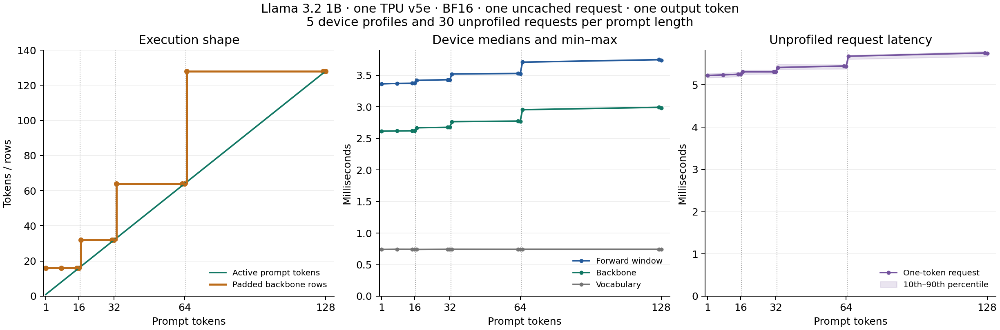

# Twice the rows, 1–5% more latency: measuring prompt padding on a TPU

A padded tensor shape can grow much faster than observed inference latency.
We measured the difference using Llama 3.2 1B Instruct on one Cloud TPU v5e
chip, with real BF16 checkpoint weights and upstream vLLM TPU / tpu-inference
0.30.0. All experiments in this report were run on 2026-10-18.

## The result

| Prompt tokens | Padded backbone rows | Device forward median | Change in forward medians |
| --- | --- | --- | ---: |
| 16 → 17 | 16 → 32 | 3.374 → 3.419 ms | +1.3% |
| 32 → 33 | 32 → 64 | 3.430 → 3.520 ms | +2.6% |
| 64 → 65 | 64 → 128 | 3.527 → 3.708 ms | +5.1% |

Each boundary doubles the padded backbone rows while adding one useful token.
The measured time increase is much smaller than the row increase. Across the
entire sweep, the forward window grows from 3.363 ms for one prompt token to
3.737 ms for 128 tokens: **11.1% more device time for 128 times as many input
tokens**. The one-token condition includes the tokenizer-added beginning-of-text
token. The sweep measures exact token counts rather than complete chat messages.

The vocabulary projection remains approximately **0.740–0.744 ms**, with eight
padded rows, throughout the sweep. That is about 20–22% of the device forward
window, even though only one vocabulary output row is useful for the request.
The backbone accounts for most of the modest variation across prompt lengths.

## How we measured it

We tested prompt lengths 1, 8, 15, 16, 17, 31, 32, 33, 63, 64, 65, 127, and 128.
Every prompt is an exact prefix of the same tokenized text. Prefix caching is
disabled, and every request starts with zero computed tokens. The scheduler
budget is 128 tokens, so every measured prompt fits in one prefill step.
Each request generates exactly one output token.

We warmed each length three times, then performed 30 randomized complete timing
rounds: one request at every length per round. A separate five profiling rounds
collect device timestamps in the same randomized-block design. The model,
weights, precision, serving configuration, and process remain fixed. Compilation
and warmup are excluded from the reported observations.

The device forward window starts at the backbone module and ends when its
vocabulary projection completes. It includes intervening device work and gaps.
Request time is measured separately around unprofiled `LLM.generate` calls with
pretokenized input. It includes serving, sampling, and result delivery. It is a
one-token offline request measurement, not streaming time-to-first-token.

All 455 measured sweep requests returned the same token ID as their corresponding
warmed condition. This checks repeatability within a condition, and different prompt
lengths are allowed to produce different tokens.

## Repeatability and request-level effect

Comparing the two lengths within each profiling round gives these paired
forward-window differences:

| Prompt change | Median paired difference | Min–max over five rounds |
| --- | ---: | ---: |
| 16 → 17 | +47.3 µs | +45.3 to +48.9 µs |
| 32 → 33 | +90.6 µs | +86.4 to +91.5 µs |
| 64 → 65 | +180.4 µs | +178.4 to +185.4 µs |

Ratios of condition medians and medians of paired differences are different
statistics, so they need not imply identical absolute deltas.

The corresponding median paired increases in unprofiled one-token request time
are **58.3, 112.5, and 228.7 µs**. Paired bootstrap 95% intervals over the 30
timing rounds are approximately **[45.9, 67.6]**, **[74.8, 131.8]**, and
**[224.5, 244.4] µs**. These describe variation within this run, not uncertainty
across different machines or software versions.

The fresh 64-output-token baseline also reaches **203.2–203.7 generated
tokens/s**, including prefill and serving overhead. Its decode forward median
is 3.368 ms, closely reproducing the separately recorded earlier baseline.

## Interpretation and limits

For this small-model, single-request workload, counting padded rows substantially
overstates measured latency growth. The fixed vocabulary stage and near-flat
short-prompt backbone time show substantial costs that amortize across more
active input tokens. This is consistent with a workload that is not limited
only by dense arithmetic throughput. We did not measure memory traffic or
hardware busy counters, so the experiment does not identify a unique bottleneck.

Adding one prompt token changes useful work as well as its execution bucket.
The boundary differences therefore do not isolate the causal cost of padding.
There is also no configuration-change speedup comparison in this study.
Larger models, concurrent requests, longer contexts, and different runtime or
device versions may behave differently.

The practical lesson is to measure bucket boundaries with actual request and
device timings before predicting their impact from tensor sizes. The next
experiment is a concurrency sweep, testing how the costs seen here amortize
across multiple requests.

## Reproduce and inspect

Run the commands in the [README](../README.md). The
[full sweep table](../results/llama-1b-v5e-20261018/sweep-report.md),
[computed observations](../results/llama-1b-v5e-20261018/sweep-analysis.json), and
[provenance manifest](../results/llama-1b-v5e-20261018/provenance.json) are included.
The manifest hashes the measured runner, input records, and projected device
traces, and records hashes of the original profiler exports.
